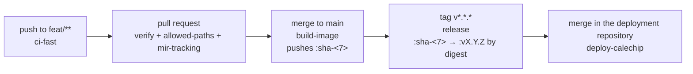

# CI/CD — how CaleChip is checked, built, released and deployed

The one page that says what runs when, what each run needs, how to cut a release and what to do when
one is bad. Written by CICD-06 from the six workflows on `main` and the deployment-repository drafts
of CICD-05. **Where this page and a workflow disagree, the workflow is right** — see
[Where else this is written](#where-else-this-is-written).

## Overview



One image is built per merge to `main`, as `mingming21400/calechip:sha-<7>`. A version tag gives that
same image a second name, `:vX.Y.Z`, by copying its manifest digest — nothing is built twice. The
release pull request it opens in the deployment repository is the deploy: merging it is human.

## Workflows

| Workflow | File | Trigger | What it does | Required check | Written by |
|---|---|---|---|---|---|
| `ci-fast` | `.github/workflows/ci-fast.yml` | push to `feat/**` | lint, typecheck, unit — fast feedback only | no | CICD-02 |
| `verify` | `.github/workflows/verify.yml` | `pull_request`; push to `main` | typecheck, lint, unit, documentation audit, hook and script tests, two e2e shards; job `verify` passes only if all did | **yes** — job `verify` | toolchain chore (2026-08-31); reshaped by CICD-02 |
| `allowed-paths` | `.github/workflows/allowed-paths.yml` | `pull_request` | `scripts/check-allowed-paths.mjs` — RULE-03 over the whole branch | **yes** | toolchain chore (2026-08-31) |
| `mir-tracking` | `.github/workflows/mir-tracking.yml` | `pull_request` (opened, edited, synchronize, reopened) | `.github/scripts/check-mir-tracking.mjs` — MIR status index and change log in step | **yes** | MIR plan (2026-10-12) |
| `build-image` | `.github/workflows/build-image.yml` | push to `main` | builds one image, smoke-tests `/healthz` and `/`, pushes `:sha-<7>` | no | CICD-03 |
| `release` | `.github/workflows/release.yml` | push of a tag matching `v*.*.*` | promotes `:sha-<7>` to `:vX.Y.Z` by digest, opens the deployment pull request, creates the GitHub Release | no | CICD-04 |
| `deploy-calechip` | deployment repository, `.github/workflows/deploy-calechip.yml` — *draft, not applied* | push to `main` touching `apps/calechip/**` | on the self-hosted runner: pull, `up --wait`, restore the previous version if unhealthy | no | CICD-05 |
| `pr-scope` | deployment repository, `.github/workflows/pr-scope.yml` — *draft, not applied* | `pull_request` to `main` | a `release/<app>-v…` pull request may change only `apps/<app>/` | optional, once it has passed | CICD-05 |

**The required checks are exactly `verify`, `allowed-paths` and `mir-tracking`.** The settings that
make them required, and why the others are not, are in
[branch-protection.md](branch-protection.md). On 2026-10-14 those settings were **not applied**:
`main` had no protection, so a red required check did not block a merge (see [Record](#record)).

## Secrets and variables

Names only. No value of any of these belongs in any file.

| Name | Kind | Set in | Read by | Scope or value |
|---|---|---|---|---|
| `DOCKERHUB_USERNAME` | secret | this repository, Settings → Secrets and variables → Actions | `build-image`, `release` | the Docker Hub account that owns `mingming21400/calechip` |
| `DOCKERHUB_TOKEN` | secret | this repository | `build-image`, `release` | a Docker Hub access token, read/write on that repository |
| `VITE_SUPABASE_URL` | secret | this repository | `build-image` | the production Supabase project's URL |
| `VITE_SUPABASE_ANON_KEY` | secret | this repository | `build-image` | the production project's anon key |
| `DEPLOY_REPO_TOKEN` | secret | this repository | `release` | a **fine-grained** token on the deployment repository **only** — Contents and Pull requests read/write, nothing else |
| `DEPLOY_REPO` | variable | this repository, *Variables* tab | `release` | the deployment repository as `owner/name` |

- **The `VITE_*` values are baked into the image at build**, as build arguments (see the
  `Dockerfile` header). One image serves one Supabase project; pointing at another project means
  another build.
- **`SUPABASE_SERVICE_ROLE_KEY` is never an Actions secret here.** Nothing in the pipeline needs it,
  and the image is a static bundle any visitor can read.
- **The deployment repository needs no secret.** Its workflows use only `github.token`. The server's
  one credential, a Docker Hub login if the image is private, lives in the runner user's Docker config
  — [deployment-repo/README.md § Secrets](deployment-repo/README.md#secrets).
- Missing any of these, `build-image` fails at its `secrets present` step and `release` at
  `inputs present`, each naming what is missing.

## Cutting a release

1. **The commit is on `main` and its `build-image` run succeeded.** That run is what pushed
   `mingming21400/calechip:sha-<7>`; without it there is nothing to promote.

   ```
   gh run list --workflow build-image.yml --branch main --limit 5 --json headSha,conclusion
   ```

2. **Choose the version `vX.Y.Z`.** The operator chooses it, by hand; nothing derives it from commit
   messages. A pre-release is `vX.Y.Z-<suffix>`, for example `v1.4.0-rc.1`.
3. **Tag the commit and push the tag:**

   ```
   git tag vX.Y.Z <sha>
   git push origin vX.Y.Z
   ```

   A tag with only two parts (`v2.0`) matches no trigger and **nothing runs**.
4. **`release` runs.** It checks its inputs, checks the tag's format, promotes `:sha-<7>` to
   `:vX.Y.Z` by digest, opens `release/calechip-vX.Y.Z` in the deployment repository, and last creates
   the GitHub Release (marked pre-release when the tag has a suffix). It refuses, and promotes nothing,
   when:
   - **the tag is not on `main`** — *"Tag … points at …, which is not on main"*. Delete the tag and
     tag a commit that is.
   - **`:sha-<7>` is not in Docker Hub** — *"… is not in Docker Hub"*. Wait for that commit's
     `build-image` to succeed, then re-run `release`.

   A version tag is never moved: if `:vX.Y.Z` already exists at another digest, the run fails.
5. **Review and merge the `release/calechip-vX.Y.Z` pull request in the deployment repository.**
   It changes one file, `apps/calechip/release.env`. **Merging it is the deploy** (RULE-09).
6. **Confirm it.** The merge starts `deploy-calechip` in the deployment repository. It is green when
   the new version is running and healthy, and it comments `deployed: …` on the release pull request
   with the run's URL. Any other comment is a case in the [Rollback runbook](#rollback-runbook).

## Rollback runbook

**No rollback touches the database.** The pipeline applies no migration (RULE-09), and a restore
brings back an image and `apps/calechip/` only. So **every migration must stay compatible with the
previous release's image**; one that is not makes every rollback below bring back a broken site.

**`:latest` is never deployed and never a rollback target.** The deploy accepts only
`mingming21400/calechip:vX.Y.Z@sha256:<digest>`.

### 1. The health check failed after a deploy

Automatic. `deploy-calechip` ends red, and its summary and the comment on the release pull request
carry one `result`. How the restore works is in
[deployment-repo/README.md § How a failed deploy is restored](deployment-repo/README.md#how-a-failed-deploy-is-restored);
what to do with each result:

- **`restored`** — the previous version is running and the revert is on the deployment repository's
  `main`. Nothing to do on the server. Find out why the new image was unhealthy before tagging again.
- **`no-previous`** — there was no earlier release to go back to; CaleChip is as `up` left it. Fix
  the image, cut a new version, and merge its release pull request.
- **`restore-failed`** — the previous version failed its health check too. CaleChip is down and
  needs a hand on the server: read `docker compose -p calechip logs` and the container's health,
  then follow case 3 once the cause is known.
- **`restore-unpushed`** — the previous version is running, but the revert commit could not be
  pushed, so the repository still pins the failed version. Push the revert to the deployment
  repository's `main` by hand, and fix its branch protection so `github-actions[bot]` may push
  ([deployment-repo/README.md § Before you apply](deployment-repo/README.md#before-you-apply),
  item 8).

### 2. The release is healthy but wrong

The health check passed, but the release is wrong in a way it cannot see.

1. In the deployment repository, open a **revert pull request of the release merge** (GitHub's
   *Revert* button on the merged release pull request, or `git revert -m 1 <merge sha>` on a branch).
2. A human reviews and merges it.
3. That merge touches `apps/calechip/`, so `deploy-calechip` deploys the previous pin through the same
   path, with the same health check. There is no "redeploy version X" button: only merged config is
   deployed.

### 3. The pipeline itself is down

The runner is offline, or GitHub is unavailable, and the server must change now.

1. On the server, in a checkout of the deployment repository, check out the commit before the bad
   release (the last known-good `apps/calechip/release.env`).
2. Run, from the repository root:

   ```
   docker compose -p calechip -f apps/calechip/compose.yml --env-file apps/calechip/release.env up -d --wait
   ```

3. When GitHub and the runner are back, **bring the repository in line with the server**: merge a
   revert pull request (case 2) so `main` pins what is running. Until it does, the next push touching
   `apps/calechip/` deploys whatever `main` says.

## Dry runs

Four end-to-end checks of the pipeline. Each is performed once after setup, and again after any
change to a workflow.

### 1. Pull request

- **Who:** anyone opening a pull request in this repository.
- **Steps:** push a `feat/<ID>` branch whose changes stay inside the ticket's `allowed_paths`, and
  open its pull request against `main`.
- **Expected:** `ci-fast` green on the push; `verify`, `allowed-paths` and `mir-tracking` green on
  the pull request. With branch protection applied, the merge button stays disabled until all three
  are.

### 2. Merge to main

- **Who:** the operator, merging a pull request.
- **Steps:** merge any pull request whose three required checks are green.
- **Expected:** `verify` green on the push to `main`; `build-image` green, with
  `mingming21400/calechip:sha-<7>` in Docker Hub and its digest in the run's summary.

### 3. Pre-release tag

- **Who:** the operator.
- **Steps:** pick a commit on `main` whose `build-image` run succeeded, then:

  ```
  git tag v0.0.0-rc.1 <sha>
  git push origin v0.0.0-rc.1
  ```

- **Expected:** `release` green; `mingming21400/calechip:v0.0.0-rc.1` with the **same digest** as
  `:sha-<7>` (`docker buildx imagetools inspect` on both); an open `release/calechip-v0.0.0-rc.1`
  pull request in the deployment repository; a GitHub Release `v0.0.0-rc.1` marked pre-release.
  Close that pull request without merging unless you mean to deploy the release candidate.

### 4. Forced health-check failure

- **Who:** the operator, on the deployment repository.
- **Starts from:** a release deployed and healthy through `deploy-calechip`.
- **Steps:** on a branch that is **not** `release/*` (so `pr-scope` does not apply), change
  `apps/calechip/compose.yml` to:

  ```yaml
      healthcheck:
        test: ["CMD", "false"]
  ```

  and merge it to `main`.
- **Expected:** `deploy-calechip` red with `result=restored`; `calechip` healthy on the previous
  digest (`docker compose -p calechip ps`); a `Restore calechip …` commit on the deployment
  repository's `main`, which also undoes the health-check change.

### Record

What has actually been observed. A row reads `success` only with a run that shows it.

| Dry run | Date observed | Run URL(s) | Conclusion | Notes |
|---|---|---|---|---|
| Pull request | 2026-10-14 | PR #134 (CICD-05), head `46ff362`: [ci-fast](https://github.com/didi-code0980/calechip/actions/runs/38513427253) · [verify](https://github.com/didi-code0980/calechip/actions/runs/38513433011) · [allowed-paths](https://github.com/didi-code0980/calechip/actions/runs/38513432948) · [mir-tracking](https://github.com/didi-code0980/calechip/actions/runs/38513432739) | failure | `ci-fast`, `verify`, `mir-tracking` success. `allowed-paths` failed at `node scripts/check-allowed-paths.mjs`: `src/components/TopBar.tsx` (chore commits on the same branch) outside CICD-05's `allowed_paths`. The pull request was merged anyway — `main` has no branch protection. |
| Merge to main | 2026-10-14 | `c4bb195` (merge of #134): [verify](https://github.com/didi-code0980/calechip/actions/runs/38524736891) · [build-image](https://github.com/didi-code0980/calechip/actions/runs/38524736841) | failure | `verify` success. `build-image` failed at `secrets present`: *Missing Actions secrets: DOCKERHUB_USERNAME DOCKERHUB_TOKEN VITE_SUPABASE_URL VITE_SUPABASE_ANON_KEY*. No image was pushed. |
| Pre-release tag | | | not run | |
| Forced health-check failure | | | not run | |

**What each row waits on before it can read `success`:**

- **Pull request** — nothing from the setup below. It needs a pull request whose branch holds only
  its ticket's files; the one before it, #133 (CICD-04), had all three required checks green. Branch
  protection ([branch-protection.md](branch-protection.md)) is what stops the next red one merging.
- **Merge to main** — the four `build-image` secrets.
- **Pre-release tag** — the four `build-image` secrets, and a `build-image` run that succeeded since;
  `DEPLOY_REPO_TOKEN` and `DEPLOY_REPO`; the deployment repository drafts applied
  ([deployment-repo/README.md § Before you apply](deployment-repo/README.md#before-you-apply)).
- **Forced health-check failure** — everything the pre-release tag needs; the runner online; a
  release already deployed and healthy.

**The operator updates this table when a dry run is performed**, with the date, the run URLs and the
conclusion as the run shows it.

## Onboarding another app

What a second app, `<app>`, needs to ship through the same deployment repository:

1. **Its own image repository** on Docker Hub, `mingming21400/<app>`.
2. **Its own `build-image` and `release`** in its own source repository, adapted from this one's:
   its image name, its build secrets, and `DEPLOY_FILE: apps/<app>/release.env` with its own
   `<APP>_IMAGE` variable.
3. **A folder `apps/<app>/`** in the deployment repository, holding its `compose.yml` with its image
   taken only from `release.env`, and a health check.
4. **A `deploy-<app>` workflow** in the deployment repository, triggered on `apps/<app>/**` only, with
   its **own `concurrency` group** (`deploy-<app>`) and its **own compose project name** (`-p <app>`),
   so one app's deploy never touches another's containers.
5. **A CODEOWNERS line** for `/apps/<app>/` in the deployment repository.

**`pr-scope` already covers any `apps/<app>/`** and needs no change.

**Later candidates for reusable workflows**: the build-and-smoke steps of `build-image`, the
promote-by-digest steps of `release`, and the deploy-health-restore steps of `deploy-calechip`.
**None exists yet**; today each app copies them.

## Where else this is written

Links only; none of their content is restated above. **Where this page and a workflow disagree, the
workflow is right.**

- [branch-protection.md](branch-protection.md) — the required checks and the protection settings.
- [deployment-repo/README.md](deployment-repo/README.md) — the deployment repository's drafts, the
  restore mechanism, the runner and its label.
- [e2e-quarantine.md](e2e-quarantine.md) — quarantining a failing end-to-end test (ADR-060).
- [.ai/standards/tech-stack.md § Build and deployment](../../.ai/standards/tech-stack.md#build-and-deployment)
  — the build and deployment facts every agent stage reads.
- [.ai/standards/git-conventions.md § Branch protection](../../.ai/standards/git-conventions.md#branch-protection)
  — branch protection as a working convention.
- Each workflow's header comment in [.github/workflows/](../../.github/workflows/) — what it needs and
  why it is shaped as it is.
